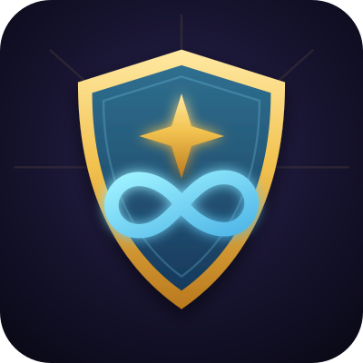

# Forever Best In Slot

A Best-in-Slot browser and tooltip addon for **World of Warcraft: Forever** (interface 16001), modelled on Loon Best In Slot.

## Install
1. Unzip so the folder sits at `World of Warcraft\_forever_\Interface\AddOns\ForeverBestInSlot\`
   (the folder must contain `ForeverBestInSlot.toc`).
2. Start the game or type `/reload`.

## Use
| Action | How |
|---|---|
| Open the BiS browser | `/bis`, the minimap button, or the addon compartment menu |
| Settings | `/bis settings`, right-click the minimap button, or Options → AddOns |
| Copy an item's web link | Click **Link** on any row, then Ctrl+C (Cmd+C on Mac) |
| Copy the source guide link | **Guide link** button at the bottom of the browser |
| Copy a link for *any* item | `/bis link` and shift-click the item into the chat box, or `/bis link 13392` |
| Put an item in chat / preview it | Shift-click / Ctrl-click the item icon |
| Toggle minimap button | `/bis minimap` |
| Holiday theme (Auto / On / Off) | `/bis holiday`, or Settings |

The browser opens on your own class and spec, shows the Alliance or Horde pick for your faction, marks items you have equipped, in bags, or in the bank (the bank is remembered after you visit it once), and has a slot filter and a "Missing only" filter. The **Gear** tab ranks each slot: 1st place (gold trophy) is the BiS item, and 2nd and 3rd place (silver and bronze) are good picks that are often easier to get, from the alternatives and the Realistic set. Click **+2 more** on a slot, or tick **2nd & 3rd**, to see them. The **Consumables** list is a raid shopping list for your spec. **Raid Check** (its own tab, `/bis raid`, and a panel beside your character window) checks your hit chance against raid bosses, defense for tanks, empty slots and missing enchants, and compares your gear's key stats with the pre-raid BiS set. There's also an **Enchants** tab for each spec. Tier 0.5 pieces show the Tier 0 piece their quest needs right under them, and **Hide finished** hides a slot once you own its BiS or Realistic item. Opening your character window shrinks the browser next to it for easy comparing. Drag the bottom-right corner to resize the window; right-click the corner to reset it. Item tooltips (when you hover an item or click an item link in chat) start with a verdict for your own spec: a green **BiS for you** line, or **Not BiS for you** followed by your BiS item for that slot and a tick if you already own it. Below that they list every class/spec the item is BiS for. Your spec is the one picked in the browser for your class, otherwise your active specialization; both verdict lines can be turned off in Settings.

## Link site
Settings → **Copy-paste link** picks the site the Link button copies:
- **Wowhead (Forever)**: `https://www.wowhead.com/forever/item={id}` (default)
- **Custom template**: any URL with `{id}` (item ID) and/or `{name}` (URL-encoded item name)

## Phases
Lists are stored per phase (`Data\Phase1.lua`, `Data\Phase2.lua`, ...). The newest phase is the default; the **Phase** button in the browser switches to older ones, and items new since the previous phase are marked **NEW**. If a spec has no list in the new phase yet, it keeps showing its latest earlier list with a notice. Settings → "Tooltips: include older phases" adds older phases to tooltips with P1/P2 tags.

To add a phase, see **UPDATING.md**.

## Data
The Pre-raid phase (`Data/Phase1.lua`, phase id 1) holds the level 60 pre-raid lists for 28 specs (Feral is split into Feral and Feral Tank). The lists come from wowtbc.gg's hand-picked WoW Forever BiS lists, cross-checked against conquestcapped.com, and every item ID was verified against Forever item databases rather than taken from Classic (many crafted items have new IDs in Forever). Check data with `lua tools/validate.lua`.

## Releasing (maintainers)
Pushing a version tag (for example `git tag 1.2.0 && git push origin 1.2.0`) runs `.github/workflows/release.yml`, which packages the addon with the BigWigs packager and uploads it to CurseForge. It needs the `CF_API_KEY` secret and `CF_PROJECT_ID` variable set in the GitHub repository settings. `.pkgmeta` keeps `tools/`, `media/` and `UPDATING.md` out of the player download and uses `CHANGELOG.md` as the release notes, so update it before each release.
